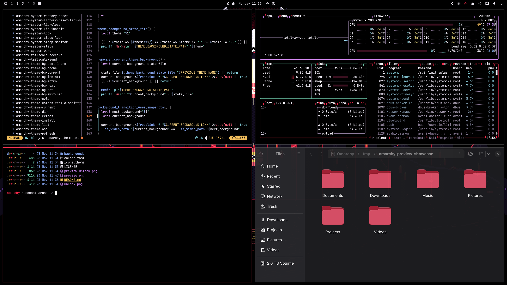
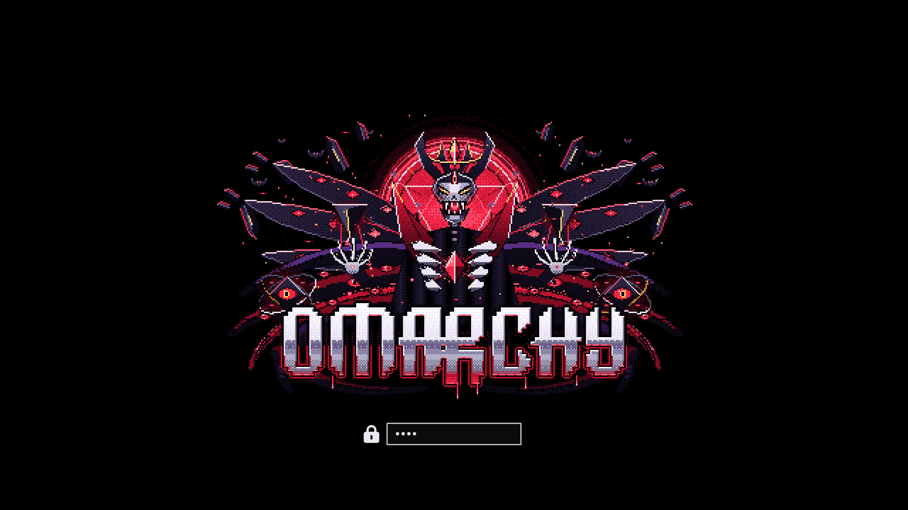

# Resonant Archon — an Omarchy OLED Theme

A **true `#000000` OLED black** and **crimson** theme for [Omarchy](https://omarchy.org), featuring eight original 4K 16-bit pixel-art eldritch boss wallpapers and a matching Plymouth/SDDM boot & login unlock screen built around the canonical Omarchy pixel font.



## Install

### 1. Install the desktop theme

```bash
omarchy theme install https://github.com/3d02/omarchy-resonant-archon-theme.git
```

Or open the Omarchy menu (**Install → Style → Theme**) and paste the repository URL.
Switch themes anytime via **Appearance → Theme** (or `omarchy theme set "Resonant Archon"`), and cycle through all eight 4K wallpapers with `Super+Ctrl+Space` or `omarchy theme bg next`.

### 2. Enable the included Boot & Login Unlock Screen (optional)

This theme bundles a custom true-black OLED Plymouth + SDDM unlock screen (`unlock.png` + `preview-unlock.png`). Omarchy keeps desktop themes and boot unlock screens separate so switching desktop themes never triggers `sudo` or an initramfs rebuild — once the theme is installed, `resonant-archon` automatically appears in Omarchy's built-in unlock picker:



Enable it from the Omarchy menu (**Appearance → Unlock → `resonant-archon`**), or from the terminal:

```bash
omarchy plymouth set by theme resonant-archon
```

*(Prefer a crimson `#ff2a4b` lock & password prompt instead of the default moonlit bone `#ece8f2`?)*

```bash
omarchy plymouth set '#000000' '#ff2a4b' ~/.config/omarchy/themes/resonant-archon/unlock.png
```

Restore the default Omarchy boot screen anytime via **Appearance → Unlock → `default`** or `omarchy plymouth reset`.

## The 8-Wallpaper 4K OLED Boss Pantheon

All eight wallpapers are rendered on crisp 16-bit Bayer-dithered pixel-art grids upscaled by exact integer nearest-neighbor to native `3840×2160` 4K with true `rgb(0, 0, 0)` OLED black voids:

| # | Boss | File |
|---|---|---|
| 1 | **The Resonant Archon (Void)** — Minimal OLED horned obsidian sovereign, floating cathedral ribs & suspended crimson heart | [`backgrounds/1-resonant-archon-oled.png`](backgrounds/1-resonant-archon-oled.png) |
| 2 | **The Crimson Leviathan** — Coiling bone-spined elder wyrm mid-strike blasting a shattered gothic cathedral courtyard | [`backgrounds/2-blood-moon-cathedral.png`](backgrounds/2-blood-moon-cathedral.png) |
| 3 | **The Hollow Conductor** — Six-armed clockwork porcelain-and-brass automaton maestro conducting slashing sentinel knights before a cathedral pipe organ | [`backgrounds/3-the-hollow-conductor.png`](backgrounds/3-the-hollow-conductor.png) |
| 4 | **The Crimson Weaver** — Eight-legged obsidian-and-bone arachnid empress suspended across a glowing silk web | [`backgrounds/4-the-crimson-weaver.png`](backgrounds/4-the-crimson-weaver.png) |
| 5 | **The Volt-Executioner** — Mid-air Castlevania duel: crimson hunter's lightning chain-whip clashing against a Tesla-crowned thunder-reaper | [`backgrounds/5-the-volt-executioner.png`](backgrounds/5-the-volt-executioner.png) |
| 6 | **The Storm Seraph** — Six-winged armored thunder-valkyrie plunging diagonally through a shattering gothic belltower | [`backgrounds/6-the-storm-seraph.png`](backgrounds/6-the-storm-seraph.png) |
| 7 | **The Thunder Hydra** — Three-headed armored storm-wyrm surging from the abyss unleashing a full-screen plasma lightning cannon | [`backgrounds/7-the-thunder-hydra.png`](backgrounds/7-the-thunder-hydra.png) |
| 8 | **The Resonant Archon (Throne Arena)** — Zoomed-in final-boss showdown inside a shattered gothic throne room with pillars, stained glass, braziers & floor lightning | [`backgrounds/8-resonant-archon-throne.png`](backgrounds/8-resonant-archon-throne.png) |

## Palette

Designed for OLED panels with a **17.39:1** foreground/background contrast ratio (WCAG AAA) and clean, legible ANSI syntax colors:

| Role | Hex | Notes |
|---|---|---|
| `background` | `#000000` | True OLED pixel-off black |
| `darker_background` / `dark_background` / `lighter_background` | `#06040a` / `#0c0814` / `#181124` | Layered deep obsidian UI surfaces |
| `foreground` / `bright_foreground` | `#ece8f2` / `#ffffff` | Moonlit porcelain bone |
| `accent` / `red` | `#ff2a4b` | Resonant crimson |
| `selection` | `#3b1020` | Deep blood velvet |
| `muted` | `#7e6e8a` | Shadow slate |
| `yellow` / `orange` | `#f2be5c` / `#eb7a44` | Byzantine gold & ember |
| `green` / `cyan` / `blue` / `magenta` | `#6bc4a6` / `#7ec4cf` / `#7d9be0` / `#c27ee8` | Balanced syntax highlights |

## What's Inside

- `colors.toml` — generates themes for Ghostty, Foot, Alacritty, Kitty, Hyprland, Omarchy shell (bar/menus/notifications/lock), Neovim, Helix, btop, Chromium, VS Code, Obsidian, and more
- `icons.theme` — `Yaru-red` file manager icons
- `backgrounds/` — 8 bespoke 4K (`3840×2160`) 16-bit pixel-art OLED wallpapers
- `unlock.png` & `preview-unlock.png` — Plymouth + SDDM unlock screen assets
- `preview.png` — 16:9 (`2560×1440`) desktop showcase

## License

MIT — see [LICENSE](LICENSE).
